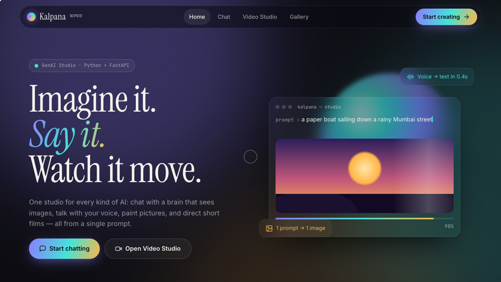

# Kalpana · GenAI Studio (कल्पना)



> **Imagine it. Say it. Watch it move.**
> One web app for every kind of generative AI: **text, voice, images and video**.

A full-stack generative-AI prototype: a **Python + FastAPI** back end that connects 5 AI APIs,
and a **hand-built HTML/CSS/JavaScript** front end with a premium, animated UI.

---

## ✨ Features

| Page | What it does |
|------|--------------|
| **Home** | Animated landing page: aurora background, typewriter demo, scroll reveals, live API status |
| **Chat** (ChatGPT-style) | Streaming answers · markdown + code · image understanding (upload / drag & drop / paste) · voice typing with live waveform · spoken replies (10 voices) · 4 personalities · saved conversations · **the AI decides by itself when to create an image or a video** |
| **Video Studio** (Kling-style) | Text → Video · Image → Video · **AI Story** (multi-scene film with narrator) · AI prompt enhancer · editable scenes · engine / ratio / duration options · live cost estimate · progress ring with stage checklist |
| **Gallery** | Masonry grid of everything you created · filters · hover-to-play · lightbox · download · delete |

## 🧠 AI APIs used

| Job | API / model | Key in `.env` | Cost |
|-----|-------------|---------------|------|
| Brain (chat, vision, tool calling) | OpenAI `gpt-5.4-mini` | `OPENAI_API_KEY` | Paid, cheap |
| Voice → text | Groq `whisper-large-v3-turbo` (backup: OpenAI) | `GROQ_API_KEY` | Free |
| Text → voice | OpenAI `gpt-4o-mini-tts` | `OPENAI_API_KEY` | Paid, cheap |
| Story writing, prompt enhance | Google Gemini `gemini-2.5-flash` (backup: OpenAI) | `GEMINI_API_KEY` | Free |
| Text → image | Gemini image (backup: OpenAI `gpt-image-1-mini`) | `GEMINI_API_KEY` / `OPENAI_API_KEY` | ~$0.01 |
| Real AI video | Runway `gen4.5` / `gen4_turbo` | `RUNWAY_API_KEY` | Paid credits |
| Motion Preview video | AI image + cinematic camera move with **ffmpeg** | — | ~$0.01 |

**Auto mode:** videos try Runway first; if Runway fails (for example no credits), the app makes a
Motion Preview instead and tells you, so the demo always works.

## 🏗️ Architecture

```
 Browser (HTML/CSS/JS)                      FastAPI server (Python)                    AI APIs
 ───────────────────────                    ───────────────────────                    ───────
 Chat page  ── POST /api/chat ───────────►  brain.py  ── stream + tool calling ──────►  OpenAI GPT
            ◄── Server-Sent Events ───────   (text, image, video, status events)
 Mic        ── POST /api/transcribe ─────►  speech.py ─────────────────────────────►  Groq Whisper
 🔊 button  ── POST /api/speak ──────────►  speech.py ─────────────────────────────►  OpenAI TTS
 Studio     ── POST /api/videos ─────────►  studio.py  (background job thread)
            ── GET  /api/jobs/{id} (poll) ◄  progress %, stage, result
                                            media.py  ── images ───────────────────►  Gemini / OpenAI
                                                      ── videos ───────────────────►  Runway / ffmpeg
                                            MoviePy joins scenes + narrator voice
 Gallery    ── GET  /api/gallery ────────►  files in storage/
```

## 🚀 Run it

```bash
cd ~/Desktop/GENAI_STUDIO
./run.sh
```
It opens **http://localhost:8000**. (First run installs the libraries.)
Needs Python 3.11+ and ffmpeg (`brew install ffmpeg`). Put your keys in `.env` (see `.env.example`).

## 📁 Project structure

```
GENAI_STUDIO/
├── backend/
│   ├── main.py      FastAPI app: all REST endpoints + serves the website
│   ├── config.py    keys, model names, folders, which features are on
│   ├── brain.py     chat: streaming, memory, personalities, function calling
│   ├── speech.py    speech-to-text (Groq → OpenAI) and text-to-speech
│   ├── media.py     images (Gemini → OpenAI), videos (Runway / Motion Preview)
│   └── studio.py    Video Studio: story writer, background jobs, final edit
├── frontend/
│   ├── index.html   all pages (single-page app) + SVG icon set
│   ├── styles.css   design system: tokens, glassmorphism, animations, responsive
│   ├── app.js       router, chat streaming, recorder, studio, gallery
│   └── assets/      favicon
├── storage/         generated images, videos (created automatically)
├── .env             your API keys (never share)
├── requirements.txt
└── run.sh           one-click start
```

## 🔌 REST API

| Method | Endpoint | Purpose |
|--------|----------|---------|
| GET | `/api/status` | Which engines are switched on |
| POST | `/api/chat` | Chat reply as a live event stream |
| POST | `/api/transcribe` | Audio file → text |
| POST | `/api/speak` | Text → MP3 |
| POST | `/api/enhance` | Short idea → cinematic prompt |
| POST | `/api/story` | Idea → multi-scene script (JSON) |
| POST | `/api/image` | Prompt → image |
| POST | `/api/videos` | Start a video job → `job_id` |
| GET | `/api/jobs/{id}` | Job progress / result |
| GET / DELETE | `/api/gallery` | List / delete creations |

Interactive API docs (auto-generated by FastAPI): **http://localhost:8000/docs**

## 🎨 UI design and tools

The design follows the same hand-built approach as the **VVP** and **KKBM** websites
(no UI framework: plain HTML + CSS + JavaScript), with its own identity:

- **Google Fonts pairing:** *Instrument Serif* (display) + *Inter* (UI) + *JetBrains Mono* (labels) + *Noto Serif Devanagari* (कल्पना)
- **CSS design tokens** (`--bg`, `--violet`, `--cyan`, `--saffron`, `--ease`) and a dark "ink" theme
- **Glassmorphism** (`backdrop-filter`), animated **aurora** gradients, SVG **film grain**
- **Custom cursor** and mouse-following **spotlight** cards (`requestAnimationFrame`)
- **Scroll reveal** and **animated counters** (`IntersectionObserver`)
- `@keyframes` motion: typewriter demo, marquee, floating orb, progress ring (`@property`)
- **Responsive**: desktop layout, collapsible sidebar, phone bottom tab bar; respects `prefers-reduced-motion`
- Small libraries from a CDN: **marked** (markdown) + **DOMPurify** (safe HTML)

## 🐍 Python concepts covered

- **Basics:** functions, loops, dictionaries, f-strings, file handling
- **Intermediate:** modules, `.env` secrets, JSON, regex, exceptions, `pathlib`, base64
- **Advanced:** REST API with **FastAPI** + Pydantic, **generators** and **Server-Sent Events** streaming,
  **threads** and background jobs with a lock, polling long-running cloud tasks, **function calling** (AI agents),
  fallback chains between providers, `subprocess` + ffmpeg, video editing with MoviePy, path-safety checks

## 🗣️ Demo script (for the viva)

1. **Home** → show the animations and the live API status pills.
2. **Chat** → ask *"Explain recursion like I'm 10"* (streaming + markdown + voice).
3. Click 🎤, speak a question → it appears in the box → Send.
4. Upload a photo → *"What is in this image?"*
5. *"Draw a cute astronaut cat"* → the AI chooses the image tool by itself.
6. *"Now animate that image"* → it makes a video from the last image.
7. **Video Studio** → AI Story → *Inspire me* → *Write the story* → edit a scene → **Generate** → watch the progress ring.
8. **Gallery** → everything created is there; open it in the lightbox.
9. Open **/docs** to show the REST API.
